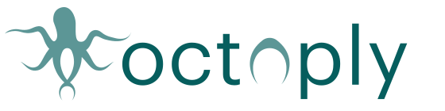

  <picture>
    <source media="(prefers-color-scheme: dark)" srcset="https://raw.githubusercontent.com/OctoplyHQ/.github/main/profile/logo-dark.png">
    
  </picture>

  <strong>A coordination company.</strong> 
  We originate ideas and develop them until they can stand on their own.

  <a href="https://octoply.com">octoply.com</a> ·
  <a href="https://www.linkedin.com/company/octoply/">LinkedIn</a> ·
  <a href="mailto:contact@octoply.co.uk">contact@octoply.co.uk</a>

---

We work at the level of systems: how waste, water and energy connect, rather
than optimising any one of them. Ideas are tested on working assets on the
tidal Thames, and each project is held together at Octoply until it is ready
to be its own organisation. We work with other organisations, institutions
and people.

## Projects

**FLO-RA**: a concept for large-scale floating bioreactors in offshore environments
- **FOR-NH**: Floating Reclaimed Ammonia, the ammonia-focused programme

**[Robin's Hood](https://r-hood.co/)**: a coordination system that records how work gets done and who did it
- **Pacience**: the decision layer
- **Team Book**: the administrative layer

## Started here, now independent

**Tamesis Dock Limited** started at Octoply and now runs as its own business,
operating floating venues on the Thames: [Tamesis Dock](https://www.tdock.co.uk/)
on the Albert Embankment and [Battersea Barge](https://www.batterseabarge.com/).
